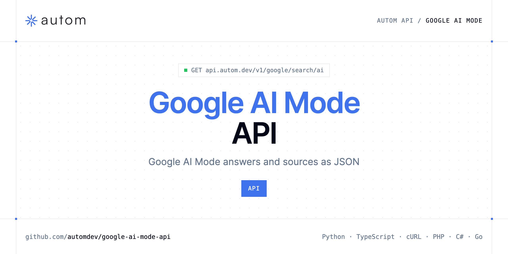

<p align="center">
  <a href="https://www.autom.dev"></a>
</p>

# Google AI Mode API

[](https://discord.gg/CFj3ph8aHU) [](https://app.autom.dev/register) [](https://docs.autom.dev) [](LICENSE)

The **Autom Google AI Mode API** returns Google's AI Mode answer and its cited sources as structured JSON.

- **Google AI Mode API** — Query Google AI Mode via API.

Use it to monitor how AI search talks about your brand (GEO), track cited sources or benchmark AI answers.

| Endpoint | Request | Credits |
|---|---|---|
| [Google AI Mode API](#google-ai-mode-api) | `GET /v1/google/search/ai` | 3 |

## Table of contents

- [How it works](#how-it-works)
- [Google AI Mode API](#google-ai-mode-api)
- [Code examples in other languages](#code-examples-in-other-languages)
- [Use cases](#use-cases)
- [Why Autom?](#why-autom)
- [FAQ](#faq)
- [Related repositories](#related-repositories)
- [Support](#support)

## How it works

1. **Create a Autom account** and copy your API key from the [dashboard](https://app.autom.dev/register).
2. **Call `https://api.autom.dev`** with the header `x-api-key: YOUR_API_KEY`.
3. **Use the result** in your app — no infrastructure to run.

```bash
export AUTOM_API_KEY="your-api-key"
pip install requests        # Python
# TypeScript: Node.js 18+ (native fetch), run with `npx tsx file.ts`
```

## Google AI Mode API

Query Google AI Mode via API. JSON with text_blocks, references, and shopping_results.

`GET https://api.autom.dev/v1/google/search/ai` · **3 credits per request** · [API reference](https://app.autom.dev/openapi)

### Request parameters

| Parameter | In | Type | Required | Description |
|---|---|---|---|---|
| `query` | query | string | ✅ | The question or search query you want Google AI Mode to answer (supports advanced operators like `site:`, `inurl:`, `intitle:`). |
| `location` | query | string | — | Human-readable location to originate the search from (e.g. `New York, NY`, `Paris, France`). If several locations match, the most popular one is used. Note: `location` and `uule` cannot be used together. |
| `uule` | query | string | — | Google encoded location parameter. Use for precise geo targeting. Note: `uule` and `location` cannot be used together. |
| `gl` | query | string | — | Country to use for the Google AI Mode search (two-letter country code, e.g. `us`, `fr`). |
| `hl` | query | string | — | Language to use for the Google AI Mode search (two-letter language code, e.g. `en`, `fr`). |

### Python example

```python
import os

import requests

API_KEY = os.environ["AUTOM_API_KEY"]
HEADERS = {"x-api-key": API_KEY}

response = requests.get(
    "https://api.autom.dev/v1/google/search/ai",
    headers=HEADERS,
    params={
        "query": "what is mozilla firefox",
    },
    timeout=120,
)
response.raise_for_status()

data = response.json()
print(data)
```

### TypeScript example

```typescript
type GoogleAiModeApi = {
  references?: {
    link?: string;
    index?: number;
    title?: string;
    source?: string;
    snippet?: string;
    thumbnail?: string;
    source_icon?: string;
  }[];
  text_blocks?: {
    type?: string;
    snippet?: string;
  }[];
  shopping_results?: unknown[];
  search_parameters?: {
    q?: string;
    gl?: string;
    hl?: string;
    engine?: string;
  };
  reconstructed_markdown?: string;
};

const headers = { "x-api-key": process.env.AUTOM_API_KEY!, "Content-Type": "application/json" };

const params = new URLSearchParams({
  "query": "what is mozilla firefox",
});

const response = await fetch(`https://api.autom.dev/v1/google/search/ai?${params}`, { headers });
if (!response.ok) throw new Error(`HTTP ${response.status}: ${await response.text()}`);

const data = (await response.json()) as GoogleAiModeApi;
console.log(data);
```

### Output example

Example response from the API reference, abridged.

```json
{
  "references": [
    {
      "link": "https://www.mozilla.org/firefox/",
      "index": 0,
      "title": "Firefox Browser",
      "source": "mozilla.org",
      "snippet": "Official Firefox download and overview.",
      "thumbnail": "https://encrypted-tbn0.gstatic.com/images?q=tbn:ANd9GcFirefoxThumb",
      "source_icon": "https://www.google.com/s2/favicons?domain=mozilla.org&sz=128"
    },
    {
      "link": "https://en.wikipedia.org/wiki/Firefox",
      "index": 1,
      "title": "Firefox - Wikipedia",
      "source": "en.wikipedia.org"
    }
  ],
  "text_blocks": [
    {
      "type": "paragraph",
      "snippet": "Mozilla Firefox is a free, open-source web browser developed by the Mozilla Foundation. It is available on desktop and mobile, supports e…"
    },
    {
      "type": "heading",
      "level": 3,
      "snippet": "Key features"
    }
  ],
  "shopping_results": [],
  "search_parameters": {
    "q": "what is mozilla firefox",
    "gl": "us",
    "hl": "en",
    "engine": "google_ai_mode"
  },
  "reconstructed_markdown": "Mozilla Firefox is a free, open-source web browser developed by the Mozilla Foundation. It is available on desktop and mobile, supports e…"
}
```

### Response fields

| Field | Type | Description |
|---|---|---|
| `references[]` | object[] |  |
| `references[].link` | string |  |
| `references[].index` | integer |  |
| `references[].title` | string |  |
| `references[].source` | string |  |
| `references[].snippet` | string |  |
| `references[].thumbnail` | string |  |
| `references[].source_icon` | string |  |
| `text_blocks[]` | object[] |  |
| `text_blocks[].type` | string |  |
| `text_blocks[].snippet` | string |  |
| `shopping_results` | any[] |  |
| `search_parameters` | object |  |
| `search_parameters.q` | string |  |
| `search_parameters.gl` | string |  |
| `search_parameters.hl` | string |  |
| `search_parameters.engine` | string |  |
| `reconstructed_markdown` | string |  |

## Code examples in other languages

Ready-to-run examples live in [`examples/`](examples); each reads your key from `AUTOM_API_KEY`.

| Language | `google-search-ai` |
|---|---|
| cURL (Bash) | [google_search_ai.sh](examples/curl/google_search_ai.sh) |
| PHP | [google_search_ai.php](examples/php/google_search_ai.php) |
| C# | [GoogleSearchAi.cs](examples/csharp/GoogleSearchAi.cs) |
| Go | [google_search_ai.go](examples/go/google_search_ai.go) |
| Java | [GoogleSearchAiExample.java](examples/java/GoogleSearchAiExample.java) |
| Ruby | [google_search_ai.rb](examples/ruby/google_search_ai.rb) |
| Node.js | [google_search_ai.mjs](examples/nodejs/google_search_ai.mjs) |

## Use cases

- **Generative Engine Optimization** — See which sources AI Mode cites for your topics.
- **Brand monitoring** — Track how AI answers describe your brand and competitors.

## Why Autom?

- **Every SERP in one API** — Google Search, AI Mode, Maps, News, Shopping, Images, Videos, Jobs, Autocomplete, plus Bing and Brave.
- **Structured JSON** — documented fields instead of brittle HTML parsing.
- **Geo & language targeting** — search like a user from the country and language you need.
- **One API key, one header** — `x-api-key` on every request.
- **Copy-paste examples** — Python and TypeScript in each README, 7 more languages in `examples/`.

## FAQ

### How do I authenticate?

Create an account on [Autom](https://app.autom.dev/register), copy your API key and send it in the `x-api-key` header of every request to `https://api.autom.dev`.

### How much does a request cost?

Credits per call: `/v1/google/search/ai` **3**. See [Autom pricing](https://www.autom.dev/pricing).

### Which languages are supported?

Any language that can make an HTTP request. This README shows Python and TypeScript; the [`examples/`](examples) folder contains cURL, PHP, C#, Go, Java, Ruby and Node.js.

## Related repositories

- [Google Search API](https://github.com/automdev/google-search-api)
- [Google Maps API](https://github.com/automdev/google-maps-api)
- [Google News API](https://github.com/automdev/google-news-api)
- [Google Shopping API](https://github.com/automdev/google-shopping-api)
- [Google Images API](https://github.com/automdev/google-images-api)
- [Google Videos API](https://github.com/automdev/google-videos-api)
- [Google Jobs API](https://github.com/automdev/google-jobs-api)
- [Google Autocomplete API](https://github.com/automdev/google-autocomplete-api)
- [All Autom repositories](https://github.com/automdev)

## Support

- 💬 Join the [Discord](https://discord.gg/CFj3ph8aHU) to ask questions and share what you build.
- 📚 Read the [API reference](https://docs.autom.dev).
- 🔑 [Get your API key](https://app.autom.dev/register).

---

<p align="center">
  <a href="https://www.autom.dev">
    <picture>
      <source media="(prefers-color-scheme: dark)" srcset="images/logo-dark.svg">
      
    </picture>
  </a>
  <br>
  <sub>Built by <a href="https://www.autom.dev">Autom</a>. Examples are released under the MIT license.</sub>
</p>
